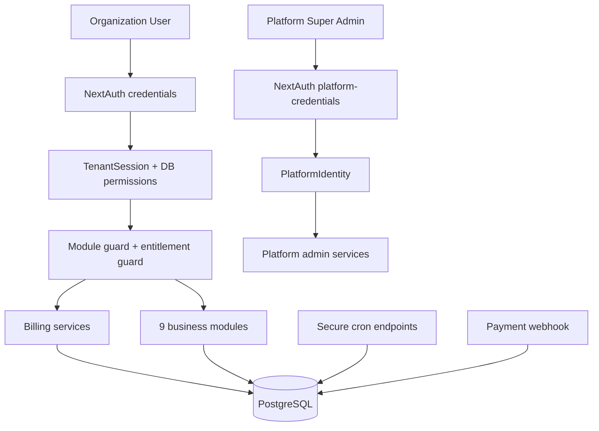
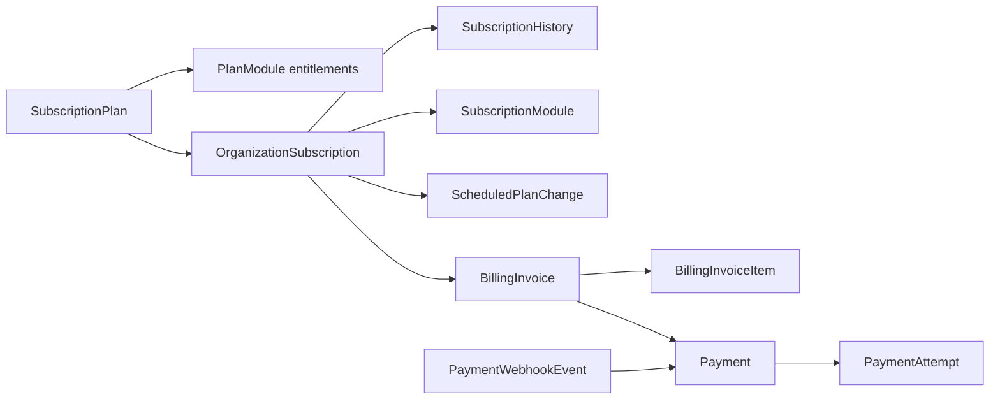
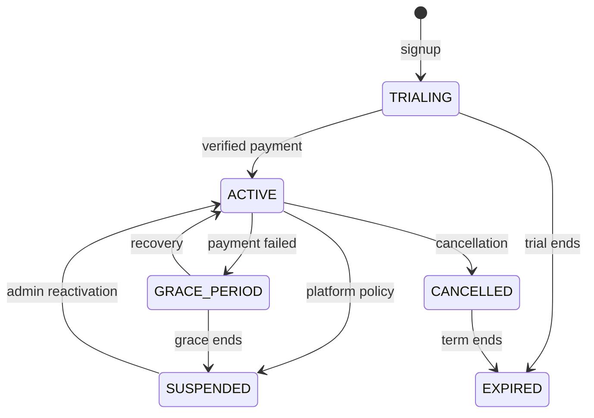

# Commercial Multi-Tenant Modular ERM

A white-label, multi-tenant Enterprise Resource Management platform with nine business modules, five cross-cutting enterprise infrastructure systems, and a complete SaaS subscription/billing layer with a separately authenticated Platform Super Admin.

## 1. Project overview

Each tenant (organization) gets isolated business data, its own roles/permissions, enabled modules, subscription entitlements, usage limits and billing records. A Platform Super Admin manages plans, organizations, subscriptions, invoices, payments and platform policy from a completely separate authentication context.

## 2. Product features

- Nine configurable business modules with organization-level activation
- DB-authoritative RBAC, audit logging, login history, enforceable session revocation and rate limiting
- Configurable multi-level approval workflows with conditions, delegation and atomic business-state transitions
- In-app/email/SMS notifications with preferences and durable scheduled reminders
- Organization settings: currency, timezone, date format, fiscal years, taxes and atomic document numbering
- CSV/XLSX import, CSV/XLSX/PDF export, backups, archival and retention
- SaaS plans, free trials, monthly/yearly billing, upgrades/downgrades, module pricing, quotas, invoices, payments, grace periods, renewals and analytics

## 3. Module list

| Key              | Module                                                     |
| ---------------- | ---------------------------------------------------------- |
| `hrm`            | Employees, attendance, leave & performance                 |
| `payroll`        | Salary structures, runs, approvals, payslips               |
| `crm`            | Customers, leads, opportunities                            |
| `projects`       | Projects, tasks, time tracking, expenses                   |
| `accounting`     | Chart of accounts, journals, ledger, banking               |
| `inventory`      | Products, warehouses, reservations, immutable stock ledger |
| `sales_purchase` | Quotations, invoices, POs, GRNs, bills, notes              |
| `reports`        | Cross-module analytics & exports                           |
| `users_roles`    | Roles, permissions, users, sessions, audit                 |

`src/core/modules/registry.ts` is the canonical module registry. Do not create a second registry.

## 4. Technology stack

Next.js 14 App Router · React 18 · TypeScript · Prisma 5 · PostgreSQL · NextAuth v5 (JWT) · bcryptjs · Zod · Tailwind CSS · Recharts · Node's built-in test runner (`tsx`). No payment SDK or spreadsheet library is required: XLSX readers/writers use `zlib`, email/SMS/gateways use `fetch`, and PDFs use the built-in generator.

## 5. System architecture



Server Actions live in `src/app/**/actions.ts` or `src/modules/**/actions.ts`; Prisma reads/writes live in `model.ts`/`service.ts`; shared contracts live in `src/core/types/index.ts`.

## 6. Folder structure

```
prisma/
  schema.prisma
  migrations/                 # 3 forward-only migrations
  seed.ts                     # roles, sample org, plans, platform admin
src/
  app/
    (auth)/                   # login, register
    (dashboard)/              # all tenant pages, incl. dashboard/billing/*
    platform-admin/           # separate platform administration area
    api/
      auth/[...nextauth]/      # both credential providers
      cron/notifications/      # reminders + deliveries
      cron/billing/            # renewals, trials, grace, downgrades
      billing/webhooks/[provider]/
      billing/invoices/[id]/pdf/
      exports/download/
  core/
    auth/ audit/ billing/ data/ modules/ notifications/ security/
    settings/ tenant/ ui/ workflows/ types/
  modules/                    # nine business modules
  shared/utils/               # CSV, PDF helpers
```

## 7. Multi-tenant architecture

Every tenant query includes `organizationId` from the server-side `TenantSession`. Client-provided organization ids are never trusted; `src/core/tenant/index.ts` provides `tenantWhere`, `assertOrganizationMatch` and `requireTenantRecord`. PostgreSQL row-level security is intentionally not enabled because it would require rewriting every existing query; isolation is enforced in application code and verified by cross-tenant tests.

## 8. Platform Super Admin vs Organization Admin

- **Platform Super Admin** is a dedicated `PlatformAdmin` row with its own email/password hash and a separate NextAuth provider id `platform-credentials`. An organization `Admin` role never grants platform access. Routes under `/platform-admin` call `requirePlatformAdmin()` / `assertPlatformAdmin()`.
- **Organization Admin** may manage only their own organization's subscription under `/dashboard/billing`, guarded by `billing.view`/`billing.manage` and tenant-scoped queries.

Create a platform administrator by setting `PLATFORM_ADMIN_EMAIL` and `PLATFORM_ADMIN_PASSWORD` (≥12 characters) and running `npm run db:seed`. Credentials are never hardcoded.

## 9. Subscription architecture



`OrganizationSubscription` is the single authoritative record per organization; history is append-only. Prices and limits come from the database and are never accepted from client input.

## 10. Subscription lifecycle

Statuses: `TRIALING`, `ACTIVE`, `PAST_DUE`, `GRACE_PERIOD`, `SUSPENDED`, `CANCELLED`, `EXPIRED`. `assertValidTransition()` rejects illegal transitions such as reactivating an expired subscription. Payment status is stored separately from subscription status.



## 11. Default plans

Seeded idempotently: **Starter** (990 BDT/mo), **Business** (2,990 BDT/mo), **Professional** (7,990 BDT/mo, recommended) and **Enterprise** (custom/negotiated, negotiated price stored as 0 with unlimited limits). Plans are editable at `/platform-admin/plans`. Existing organizations are given an active Enterprise subscription by the seed; no existing data is deleted.

## 12. Plan entitlements

`src/core/billing/entitlements.ts` exposes `getOrganizationEntitlements()`, `canAccessModule()` and `getBillingOverview()`. A module is accessible only if it is included in the plan or separately purchased **and** enabled on `OrganizationModule`. `requireModuleAccess()` and `assertActionAccess()` enforce this on the server for pages and actions.

## 13. Trial management

Registration starts one free trial from the Starter plan (trial duration read from the plan). `SubscriptionHistory` prevents a second trial for the same organization. Platform admins can extend a trial; expiry is processed by the billing cron. Expiration never deletes data — it expires the subscription and restricts access.

## 14. Monthly and yearly billing

`addMonthsClamped()` and `addYearsClamped()` handle month-end dates and leap years (31 Jan → 28/29 Feb, 29 Feb → 28 Feb). Currency defaults to BDT, is configurable per plan, and is stored on invoices with `Decimal(14,2)`. Tax is stored per invoice.

## 15. Upgrade and downgrade

Upgrade records a `ScheduledPlanChange` with status `AWAITING_PAYMENT`, a pending invoice and history; entitlements activate only after authoritative payment approval. Downgrade checks current usage and enabled modules against the target plan, explains conflicts, and schedules the change for the current billing boundary by default. Policy defaults: no automatic proration, no automatic refunds (credit/adjustment only) — both configurable in platform settings. No business data is deleted on downgrade.

## 16. Module-based pricing

`PlanModule` stores included/paid status and separate monthly/yearly prices. `purchaseModule()` activates a paid module and the matching `OrganizationModule`, and records a module purchase event in the audit log.

## 17. Usage metering

Categories: `EMPLOYEES`, `USERS`, `PROJECTS`, `STORAGE_MB`, `API_CALLS`, `INVOICES`, `WAREHOUSES`. `getOrganizationUsage()` combines live record counts with metered `UsageRecord` rows. `incrementUsage()` uses `INSERT … ON CONFLICT DO UPDATE` so concurrent consumption cannot lose an increment. `checkUsageLimit()`/`assertUsageLimit()` are called server-side when creating employees, users and projects. Storage/API/invoice/warehouse counters are ready for callers to meter.

## 18. Invoice management

`BillingInvoice` + `BillingInvoiceItem` store line items, discounts, tax rate/amount, totals, currency, issue/due/paid dates and status (`DRAFT`, `PENDING`, `PARTIALLY_PAID`, `PAID`, `OVERDUE`, `VOID`, `REFUNDED`). Finalization makes amounts immutable; corrections require void/adjustment records. PDF download is at `/api/billing/invoices/{id}/pdf` and is tenant-scoped.

## 19. Payment architecture

`PaymentProvider` abstracts `createSession`, `verify`, `parseWebhook` and optional `refund`. `initiatePayment()` validates the outstanding amount, enforces an idempotency key, and stores provider references. `verifyAndSettlePayment()` runs inside a transaction: verifies the provider (or requires explicit platform approval for manual bank transfer), settles the invoice, records attempts/audit, and restores entitlements only after settlement. Duplicate idempotency keys and duplicate webhook event ids are rejected.

## 20. Supported payment providers — actual status

| Provider             | Status                                                                                                                                                          |
| -------------------- | --------------------------------------------------------------------------------------------------------------------------------------------------------------- |
| Manual bank transfer | **Implemented and tested** — requires explicit platform approval; never auto-settles.                                                                           |
| SSLCommerz           | **Adapter implemented, unverified** — hosted checkout + validation calls are coded against documented endpoints but require real sandbox credentials to verify. |
| bKash                | **Adapter only** — refuses checkout until gateway callback contract is implemented and credentials verified.                                                    |
| Nagad                | **Adapter only** — same limitation.                                                                                                                             |

No provider is claimed as production-integrated without credentials and verification.

## 21. Bangladesh gateway configuration

Set `SSLCOMMERZ_STORE_ID`, `SSLCOMMERZ_STORE_PASSWORD`, `SSLCOMMERZ_ENVIRONMENT=SANDBOX|LIVE`, `SSLCOMMERZ_WEBHOOK_SECRET` and `BILLING_SUPPORT_EMAIL`. `NEXTAUTH_URL` must be publicly reachable for callbacks. Use `/platform-admin/gateways` for non-secret public configuration; secrets stay in the environment.

## 22. Payment webhook setup

Point SSLCommerz IPN at `{NEXTAUTH_URL}/api/billing/webhooks/sslcommerz`. The endpoint reads the raw body, verifies an HMAC-SHA256 signature, deduplicates on `eventId`, validates amount/currency/merchant reference against the stored payment, settles on `PAID`, and records failure state otherwise. Unsigned or unconfigured webhooks return 401/503 and are never trusted.

## 23. Renewal and scheduled jobs

`/api/cron/billing` requires `Authorization: Bearer $CRON_SECRET` and runs `runBillingJobs()`: trial expiry, grace expiry, scheduled downgrades, renewal invoice generation, overdue detection and audit logging. Example:

```cron
*/15 * * * * curl -X POST -H "Authorization: Bearer $CRON_SECRET" https://your-host/api/cron/billing
*/5  * * * * curl -X POST -H "Authorization: Bearer $CRON_SECRET" https://your-host/api/cron/notifications
```

Operations are idempotent via status/date guards and unique keys. `BILLING_AUTO_CHARGE_PROVIDER` is opt-in; only a verified SSLCommerz configuration may attempt unattended charging. Manual/bKash/Nagad invoices remain pending until approved or verified.

## 24. Environment variables

See `.env.example`. Required: `DATABASE_URL`, `AUTH_SECRET`, `NEXTAUTH_URL`. Platform: `PLATFORM_ADMIN_*`, `CRON_SECRET`. Billing: `BILLING_GRACE_DAYS`, `BILLING_SUPPORT_EMAIL`, optional `BILLING_AUTO_CHARGE_PROVIDER`, SSLCommerz/bKash/Nagad credentials. Also: rate-limit, Redis, notification and backup variables. Secrets are never committed.

## 25. Local installation

```bash
npm install
cp .env.example .env          # fill in DATABASE_URL and AUTH_SECRET
npx prisma migrate deploy
npm run db:seed
npm run dev
```

Organization demo login: `admin@demo-corp.com` / `Admin@123`. Platform login: `/platform-admin/login` with the credentials set via `PLATFORM_ADMIN_*`.

## 26. Prisma migrations

1. `00000000000000_baseline` — original committed schema for legacy `db push` databases (`prisma migrate resolve --applied` first).
2. `20261128000000_enterprise_core_infrastructure` — audit/session/workflow/notification/settings/data-management.
3. `20261128030000_saas_subscription_billing` — plans, subscriptions, entitlements, usage, invoices, payments, webhooks, platform identity and settings.

Forward-only, no resets. Verified on an empty temporary database and on the existing development database.

## 27. Database seeding

`npm run db:seed` creates missing system roles, sample org data, four plans with module entitlements, an active subscription for existing organizations, and optionally the platform administrator from environment variables. It never resets existing permissions or deletes records. Re-running is safe.

## 28. Development commands

`npm run dev`, `npm run build`, `npm run lint`, `npm test`, `npx tsc --noEmit`, `npx prisma validate`, `npx prisma generate`, `npx prisma migrate deploy`, `npx prisma migrate status`, `npm run billing:jobs` (one-off local billing job run).

## 29. Production deployment

Run `prisma migrate deploy` before starting the app, configure all secrets via the environment, seed the platform administrator, schedule both cron endpoints, and use shared storage for exports/backups on multi-instance deployments. Always back up before migration.

## 30. Security considerations

Dedicated platform identity; DB-authoritative RBAC; server-side price/entitlement validation; tenant-scoped queries; Zod validation on webhooks/APIs; provider signature verification; idempotency keys; rate limits on both login providers; transactional financial updates; redacted audit logs; no secrets in source, seed or UI.

## 31. Testing

`npm test` runs 80 tests including the original module tests, 12 enterprise infrastructure tests and 11 billing tests covering platform identity separation, date math, transition validation, trials, single-trial prevention, paid activation gate, module entitlements, concurrent quota increments, downgrade conflicts, invoice arithmetic, finalization, idempotent manual payments, webhook dedupe, grace/recovery and MRR calculations. Integration tests use real PostgreSQL and clean up their own tenants.

## 32. Demo credentials

- Organization: `admin@demo-corp.com` / `Admin@123`
- Platform Super Admin: `platform@example.com` / `Platform@123` when `PLATFORM_ADMIN_EMAIL`/`PLATFORM_ADMIN_PASSWORD` are configured as in `.env.example` and `.env`.
- If both platform variables are unset in development, seed creates a local-only demo `platform@demo.local` / `Platform@123`. In production no default account is created — you must configure the environment variables.

Platform passwords must be at least 12 characters; shorter values are rejected with a clear seed message. Organization credentials never work at `/platform-admin/login`, and platform credentials never grant tenant access.

## 33. Known limitations

- bKash/Nagad are adapters only; SSLCommerz is coded but not verified without credentials.
- Automatic recurring charge is opt-in and limited to verified SSLCommerz; other invoices require approval/verification.
- Storage/API/invoice/warehouse usage counters need explicit calls from upload/API paths.
- RLS is not enabled; tenant isolation is application-level.
- Local filesystem is used for export/backup artifacts.
- Payment refunds are not automated; credit/adjustment workflow is documented policy only.

## 34. Future roadmap

Complete bKash/Nagad checkout contracts, add automated refund/credit notes, proration engine, object-storage artifacts, RLS evaluation, usage-based overage billing, and a platform audit viewer.
