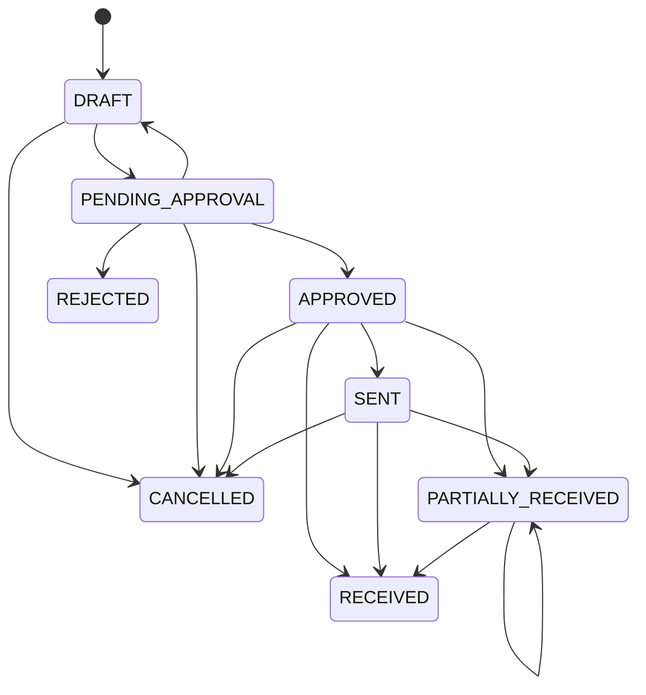

# Commercial Multi-Tenant Modular ERM v2 (Full 9-Module Suite)

Full-featured, white-label, multi-tenant Enterprise Resource Management (ERM) built with Next.js 14 App Router, Prisma ORM, PostgreSQL, and NextAuth.

## Complete Module List (All 9 Modules Included)
1. **HR Management (`hrm`)**: Employees, Daily Attendance, Leave Requests & Approvals
2. **Payroll (`payroll`)**: Monthly Salary Runs, Bonuses, Deductions, Net Pay & Disbursement
3. **CRM (`crm`)**: Leads, Pipeline Stages & Customer/Client Management
4. **Project Management (`projects`)**: Client/Internal Projects, Tasks & Deadlines
5. **Accounting (`accounting`)**: Income, Expense Tracking & Real-time Profit/Loss Calculation
6. **Inventory (`inventory`)**: Products, warehouse-wise stock, reservations, and an immutable stock movement ledger with concurrency-safe operations
7. **Sales & Purchase (`sales_purchase`)**: Draft and issued sales invoices, customer payments, stock movements, and the Purchase Order → Goods Received Note (GRN) workflow (approval lifecycle, partial receipts, stock ledger)
8. **Reports (`reports`)**: Cross-module Business Analytics & Financial Summaries
9. **User & Role (`users_roles`)**: Admin, Manager, Employee Role Creation, Permissions Matrix & User Provisioning

## Server Architecture
- `src/app/**/page.tsx` contains the Next.js views.
- `src/modules/**/actions.ts` contains server-action controllers for authorization, input handling, and route revalidation.
- `src/modules/**/model.ts` contains Prisma reads and writes for each feature.
- Shared application and domain types live in `src/core/types/index.ts`, including module inputs, permissions, auth/session contracts, dashboard data, and reusable component props. Feature modules should import shared types from `@/core/types` instead of defining duplicate contracts locally. NextAuth module augmentation stays in `src/types/next-auth.d.ts` and extends those shared auth types.
- Authorization is based on the authenticated user's active organization role and permission grants stored in PostgreSQL. Role names do not imply permissions. Every session resolution reloads the user, role permissions, and active states from the database, so permission or role changes take effect on the user's next request without trusting stale JWT permission claims.
- Role creation, permission updates, activation/deactivation, deletion, user provisioning, and user-role changes are organization-scoped and guarded by `users_roles.manage`. An administrator can delegate only permissions already granted to their own role. System roles cannot be renamed, deactivated, or deleted; a role with assigned users cannot be deactivated or deleted. Successful role and user-role changes write transactional records to `SecurityAuditLog`.

## Local Setup
1. Rename `.env.example` to `.env` and update `DATABASE_URL`.
2. Run:
   ```bash
   npm install
   npx prisma db push
   npm run db:seed
   npm run dev
   ```
3. Login at `http://localhost:3000`:
   - **Email:** `admin@demo-corp.com`
   - **Password:** `Admin@123`

### Existing Database Upgrade

For an existing database created from the previous schema, back up the database
and inspect the SQL migrations before applying them. Run
`npx prisma migrate deploy` before `npx prisma db push`. The project-task
migration converts legacy `DONE` task statuses to `COMPLETED`, adds the optional
employee assignment relation without changing existing assignee names, and
stops if it finds any unsupported task status values. The permission migration
adds role activation/version fields and transactional security audit storage,
and replaces the user-role foreign key with a tenant-scoped relation. It stops
if it finds orphaned or cross-organization user-role assignments; resolve those
records explicitly before retrying instead of bypassing the check.

After updating the schema, validate it and regenerate Prisma Client:
```bash
npx prisma validate
npx prisma generate
```

The seed command creates missing system roles and marks existing system roles,
but preserves permission changes already stored for existing roles. It is not
a permission reset mechanism. Production applications should use migrations;
do not apply migrations to a database until its backup and migration plan have
been reviewed.

## Sales Invoice & Payment Management

The Sales & Purchase invoice workflow uses the persisted statuses `DRAFT`,
`SENT`, `PARTIALLY_PAID`, `PAID`, and `CANCELLED`. `OVERDUE` is a derived
effective status: an invoice is overdue only when it is not draft, paid, or
cancelled, has an outstanding balance greater than zero, and its due date is
before the current date. The derived status is not stored as a lifecycle state.

Typical workflows are:

- `DRAFT -> SENT -> PAID`
- `DRAFT -> SENT -> PARTIALLY_PAID -> PAID`
- `SENT -> OVERDUE -> PARTIALLY_PAID -> PAID`
- `SENT -> CANCELLED`

Creating an invoice always creates a draft. Draft creation creates no payment,
accounting income, or inventory movement. An authorized user issues the draft
by setting the issue and due dates. Issuing deducts inventory once, after
stock availability is verified. The action is repeat-safe and will not deduct
stock twice. Inventory-disabled organizations continue to issue and pay invoices
without stock operations.

Confirmed customer payments are stored in `InvoicePayment` records and support
`CASH`, `BANK_TRANSFER`, `CARD`, `MOBILE_BANKING`, and `OTHER`. Full and partial
payments are supported. The outstanding balance is
`totalAmount - SUM(confirmed payments)`, always clamped at zero. Payments are
created inside the invoice transaction; accounting-disabled organizations simply
skip ledger creation. Each confirmed payment creates at most one `Sales Revenue`
transaction, linked to the payment for duplicate protection. Payment
corrections are not implemented as destructive edits or deletes; paid and
partially paid invoices require a future reversal/refund workflow rather than
silent cancellation.

Required granular permissions are:

- `sales_purchase.invoice.view`
- `sales_purchase.invoice.create`
- `sales_purchase.invoice.edit`
- `sales_purchase.invoice.issue`
- `sales_purchase.invoice.payment.record`
- `sales_purchase.invoice.payment.view`
- `sales_purchase.invoice.cancel`

The legacy `sales_purchase.view` and `sales_purchase.manage` permissions remain
accepted for backward compatibility.

To upgrade an existing database:

```bash
npx prisma migrate deploy
npx prisma validate
npx prisma generate
```

The invoice payment migration preserves existing invoice numbers, customers,
items, amounts, and historical statuses. It deliberately does not convert
legacy `PAID` invoices or fabricate payment records. Historical PAID invoices
therefore have no payment history unless payments are subsequently recorded
through the new workflow; their prior accounting and payment provenance cannot
be inferred from the old schema.

## Inventory Management — Stock Ledger, Reservations & Concurrency

### Architecture

Inventory quantity lives in `StockItem.quantity` (physical stock per
product/warehouse). Every change to it is recorded in the immutable
`StockMovement` ledger inside the same Prisma transaction.

Ledger fields include organization, product, warehouse, signed quantity
(positive = stock in, negative = stock out), `movementType`, `unitCost`,
`referenceType`/`referenceId`/`referenceNumber`, `previousQuantity`,
`newQuantity`, `notes`, `createdById` and `movementDate`/`createdAt`.

Supported movement types: `OPENING_STOCK`, `STOCK_IN`, `STOCK_OUT`,
`SALES_DEDUCTION`, `SALES_RETURN`, `TRANSFER_IN`, `TRANSFER_OUT`,
`ADJUSTMENT_IN`, `ADJUSTMENT_OUT`, `DAMAGED`, `LOST`, `EXPIRED`,
`PURCHASE_RECEIPT`, `RESERVED`, `RESERVATION_RELEASED`.

Balances:

- `Physical Stock` = `StockItem.quantity`
- `Active Reserved Stock` = SUM of ACTIVE `StockReservation.reservedQuantity`
- `Available Stock` = Physical − Active Reserved

Business rules:

- No stock can go negative: every decrease is validated inside the transaction
  before the balance and ledger entry are written.
- Historical ledger rows are append-only; corrections use compensating entries.
- Reservations are separate from physical movements: reserving stock does not
  move physical inventory or create a misleading stock-out ledger entry.
- All stock operations are tenant-scoped and permission-protected.
- Every operation revalidates `/inventory/products`, `/inventory/stock-ledger`
  and `/inventory/reservations` after success.

### Inventory Workflow

- **Stock In** (`stockInAction` → `stockIn`): validates quantity, increments
  physical stock and records a `STOCK_IN` movement.
- **Stock Out** (`stockOutAction` → `stockOut`): validates available physical
  stock, decrements it and records a `STOCK_OUT` movement.
- **Transfer** (`transferStockAction` → `transferStock`): locks the source
  stock row, validates availability, decrements the source, creates/upserts the
  destination stock row, and records two movements (`TRANSFER_OUT`,
  `TRANSFER_IN`) sharing a common `referenceId`/`referenceNumber`. All in one
  transaction; a failed transfer never leaves a one-sided change.
- **Adjustment** (`adjustStockAction` → `adjustStockPosting`): supports
  `INCREASE`, `DECREASE`, `DAMAGED`, `LOST`, `EXPIRED` and `COUNT_CORRECTION`,
  requires a reason, records a `StockAdjustment` row and a matching ledger
  movement (immutable; corrections require new adjustment entries).
- **Reservation** (`reserveStock`): atomically checks
  `Physical − Active Reserved >= quantity` and creates an ACTIVE
  `StockReservation` with optional `expiresAt`. No physical movement.
- **Release / Consume**: `releaseReservationAction` marks a reservation
  RELEASED (restoring available stock); `consumeReservationAction` deducts
  physical stock exactly once with a `STOCK_OUT` movement and marks it
  CONSUMED. `expireStaleReservationsAction` marks expired ACTIVE reservations
  EXPIRED idempotently.
- **Sales posting** (`issueInvoice`, `sales/model.ts createInvoice`): calls
  `deductStockForSales` inside the transaction. Draft invoices never touch
  stock. Posting validates physical and available stock, creates
  `SALES_DEDUCTION` movements and consumes any matching reservations. A
  repeated posting is rejected (no double deduction). Cancelling a posted
  invoice creates compensating `SALES_RETURN` movements and restores stock;
  the original deduction is never edited.
- **Purchase receipt**: GRN posting creates `PURCHASE_RECEIPT` movements only
  for accepted quantities. PO creation/approval/sending never touch stock.

### Concurrency Strategy

Stock, reservation and sales operations use Prisma interactive transactions
with `SELECT … FOR UPDATE` on the relevant `StockItem` row. The lock serializes
concurrent operations on the same product/warehouse: a second transaction waits
for the first to commit, then re-reads the balance inside its own transaction
before validating. Conditional checks (no `Math.max(0, …)` clamping) reject
oversell rather than silently zeroing stock. Tests cover two concurrent sales
(7 + 6 units against 10 available) and concurrent reservations — at most one
operation can consume the contested quantity.

### Inventory UI

- `/inventory/products` — physical, reserved and available stock per product
  and warehouse, reorder alerts, stock valuation, and actions for Stock In,
  Stock Out, Transfer, Adjust, View Ledger and View Reservations.
- `/inventory/stock-ledger` — summary cards (stock in, stock out, active
  reservations, stock value), filters (product, warehouse, movement type,
  reference, date range), server-side pagination, and a full ledger table with
  previous/new balances, reference links and notes.
- `/inventory/reservations` — reservation list with status filters, and
  release/consume/expire actions.

### Permissions (Inventory)

`inventory.view`, `inventory.manage` (legacy), `inventory.read`,
`inventory.create`, `inventory.update`, `inventory.adjust`,
`inventory.transfer`, `inventory.reserve`, `inventory.release_reservation`,
`inventory.receive_goods`, `inventory.view_ledger`, `inventory.delete`.
The seeded Manager role carries the inventory permissions; Admin uses `*`.

### Database — Inventory Ledger

New Prisma models: `StockMovement` (enhanced with `referenceNumber`,
`previousQuantity`, `newQuantity`, `notes`, `invoiceId`), `StockReservation`,
`StockAdjustment`; new back-relations on Organization, Product, Warehouse,
User and Invoice. Indexes cover organization/product/warehouse/movement-type,
organization/creation date, reservation status/reference and adjustment type.

Migration `20261126113000_inventory_stock_ledger_and_reservations` creates the
tables/indexes and backfills one `OPENING_STOCK` movement per existing
`StockItem` balance (skipping zero quantities), so historical balances remain
preserved and traceable.

## Purchase Order & Goods Received Note (GRN) Workflow

The Sales & Purchase module implements a real procurement workflow. Creating a
Purchase Order does **not** change inventory; goods enter stock only through
valid Goods Received Notes (GRNs) recorded against approved orders.

### Purchase Order Lifecycle

Persisted statuses: `DRAFT`, `PENDING_APPROVAL`, `APPROVED`, `SENT`,
`PARTIALLY_RECEIVED`, `RECEIVED`, `REJECTED`, `CANCELLED`.

Valid transitions (server-enforced):



Server actions (`src/modules/sales_purchase/actions.ts`) and service functions
(`src/modules/sales_purchase/service.ts`):

- `createPurchaseOrderAction` / `createPurchaseOrder` — creates the PO in
  `DRAFT` with a unique PO number, supplier, warehouse, expected delivery date,
  and items. Stock and accounting are untouched.
- `submitPurchaseOrderForApprovalAction` — `DRAFT` → `PENDING_APPROVAL`.
- `approvePurchaseOrderAction` — `PENDING_APPROVAL` → `APPROVED`; records who
  approved (`PurchaseOrderApproval` row + `PurchaseOrder.approvedById/approvedAt`).
- `rejectPurchaseOrderAction` — `PENDING_APPROVAL` → `REJECTED` with a recorded
  reason. Rejection is terminal.
- `sendPurchaseOrderAction` — `APPROVED` → `SENT`.
- `cancelPurchaseOrderAction` — from `DRAFT`, `PENDING_APPROVAL`, `APPROVED`,
  `SENT` or `PARTIALLY_RECEIVED`; records a cancellation reason.
- `createGoodsReceiptAction` / `createGoodsReceipt` — the receipt workflow below.
- `getPurchaseOrderRemainingQuantities(organizationId, purchaseOrderId?)` —
  computed per-item: `Remaining = Ordered Quantity − Previously Accepted Quantity`.
- `getGoodsReceipts(organizationId)` / `getGoodsReceiptById(organizationId, id)` /
  `getStockMovementsForGoodsReceipt(...)` — receipt reads.

### Goods Received Note (GRN)

A GRN records the physical goods received from a supplier.

- A GRN is only valid when the PO is in `APPROVED`, `SENT` or
  `PARTIALLY_RECEIVED`.
- Per PO item, `Remaining = orderedQuantity − previouslyReceived`. Receipt
  lines cannot exceed the remaining quantity (no over-receipt by default).
- Each line validates `receivedQuantity = acceptedQuantity + rejectedQuantity`.
- Accepted quantities increase `StockItem` and create `StockMovement` rows with
  movement type `PURCHASE_RECEIPT`. Rejected quantities never touch stock.
- `previouslyReceived` on the PO item is updated by accepted quantities, so
  repeated partial receipts accumulate until
  `previouslyReceived >= orderedQuantity`, at which point the PO becomes
  `RECEIVED` (with `receivedDate` set).
- All GRN operations run inside a `$transaction`. A `SELECT … FOR UPDATE` lock on
  the Purchase Order row serializes concurrent receipts, so two simultaneous
  receipts cannot both consume the same remaining quantity.
- Retry safety: `GoodsReceipt.idempotencyKey` (unique per organization) returns
  the existing receipt on resubmission and never duplicates stock. The
  `StockMovement` table has a unique `[goodsReceiptId, productId, warehouseId]`
  index.
- Account trail: when the accounting module is enabled, GRN creation creates an
  `EXPENSE` / `Inventory Purchase` transaction referencing the GRN. Purchase
  order creation, approval and sending never create accounting entries; supplier
  invoices and payments are separate events.

### Purchase Order UI

- `/sales-purchase/purchases` — PO list with search, status filters, order/expected
  date range filters and pagination. Columns: PO #, Supplier, Warehouse, Order
  Date, Expected Delivery, Total, Received Qty, Received Amount, Remaining,
  Status, Created By/At, Actions.
- `/sales-purchase/purchases/[id]` — PO details: supplier, warehouse, order items
  (ordered, previously received, remaining, unit cost, totals), approval
  history, receipt history and an activity timeline. Actions per status and
  permission: Edit Draft, Submit for Approval, Approve, Reject, Send to
  Supplier, Cancel, and a Create GRN form.
- `/sales-purchase/receipts` and `/sales-purchase/receipts/[id]` — GRN list and
  details (items table with ordered/previously received/remaining/received/
  accepted/rejected/unit cost, plus related stock movements).

### Purchase Order and Inventory Integration

- PO creation, approval and sending do not change `StockItem` or create
  `StockMovement` rows.
- Only accepted quantities from valid GRNs increase `StockItem`.
- `StockItem.quantity` and the `StockMovement` ledger are updated in the same
  transaction, so they stay consistent.

### Audit Trail

`SecurityAuditLog` rows record: `PO_CREATED`, `PO_UPDATED`,
`PO_SUBMITTED_FOR_APPROVAL`, `PO_APPROVED`, `PO_REJECTED`, `PO_SENT`,
`PO_CANCELLED`, `PO_PARTIALLY_RECEIVED`, `PO_RECEIVED`, `GRN_CREATED` —
with actor, organization, timestamp, entity and before/after data.

### Permissions (Sales & Purchase)

- `sales_purchase.po.view` — view Purchase Orders
- `sales_purchase.po.create` — create Purchase Orders
- `sales_purchase.po.edit` — edit DRAFT Purchase Orders
- `sales_purchase.po.submit` — submit for approval
- `sales_purchase.po.approve` — approve
- `sales_purchase.po.reject` — reject
- `sales_purchase.po.send` — send to supplier
- `sales_purchase.po.cancel` — cancel
- `sales_purchase.grn.view` — view GRNs / receipt history
- `sales_purchase.grn.create` — create GRNs
- Legacy `sales_purchase.view` and `sales_purchase.manage` remain accepted
  (backward compatibility).
- The **Manager** role is seeded with the PO and GRN permissions; **Admin**
  receives all permissions via `*`.

### Database Migration & Legacy Data

New migrations in `prisma/migrations/`:

- `20261126100000_purchase_order_grn_workflow` — adds `GoodsReceipt`,
  `GoodsReceiptItem`, `StockMovement`, `PurchaseOrderApproval` tables; adds
  workflow columns to `PurchaseOrder` and `PurchaseOrderItem` (renaming legacy
  `quantity` → `orderedQuantity`, adding `previouslyReceived`, `expectedDate`,
  `receivedDate`, `warehouseId`, `legacyReceivedAt`, etc.). Backfills
  `PurchaseOrder.warehouseId` from the organization's first warehouse.
- `20261126100100_purchase_order_created_by` — adds `PurchaseOrder.createdById`.
- `20261126113000_inventory_stock_ledger_and_reservations` — adds the
  `StockReservation` and `StockAdjustment` tables, enhances `StockMovement`
  (`referenceNumber`, `previousQuantity`, `newQuantity`, `notes`, `invoiceId`),
  indexes, and creates `OPENING_STOCK` movements for existing stock balances.

Legacy handling: Purchase Orders that existed with status `RECEIVED` before this
workflow were marked with `legacyReceivedAt` and are treated as terminal, without
fabricated receipt history or stock movements. Their stock was already reflected
in existing `StockItem` values when they were created.

Upgrade:

```bash
npx prisma validate
npx prisma generate
npx prisma migrate deploy
npx prisma migrate status
```

Do not apply migrations to the database without a backup and migration plan
review (see `Existing Database Upgrade` above).

### Testing

```bash
npm test
```

Includes:

- Purchase Order status lifecycle unit tests (`src/modules/sales_purchase/po-status.test.ts`)
- Purchase Order + GRN database integration tests (`src/modules/sales_purchase/grn.service.test.ts`),
  run against the development database and cleaning up their test organization after each test.
  Coverage includes: PO creation does not change stock, full receipt updates stock,
  partial receipts, rejected goods, over-receipt rejection, duplicate GRN handling,
  cross-tenant rejection, and concurrent-receipt safety.
- Inventory ledger integration tests (`src/modules/inventory/stock-ledger.test.ts`):
  stock in/out movements with previous/new balances, adjustments, linked transfer
  movements, insufficient stock rejection and ledger/stock consistency.
- Reservation tests (`src/modules/inventory/stock-reservation.test.ts`):
  reserve, over-reservation rejection, release, consume once, expiration and
  concurrent reservation safety.
- Concurrency tests (`src/modules/inventory/stock-concurrency.test.ts`): two
  simultaneous sales (7 + 6 against 10 available) never oversell; sales respect
  reservations and consume them exactly once.
- Sales/inventory integration tests
  (`src/modules/sales_purchase/invoice-inventory-integration.test.ts`): draft
  invoice does not deduct stock, posting deducts once with ledger entries,
  insufficient stock fails, repeated posting blocked, cancellation creates
  compensating `SALES_RETURN` entries, cross-tenant rejection.
- Existing invoice and permissions tests (`src/modules/sales_purchase/workflow.test.ts`,
  `src/lib/permissions.test.ts`).

All integration and concurrency tests use real PostgreSQL transactions via the
development database (`DATABASE_URL`) and create/remove their own tenant data.

### Authorization Tests

Run the permission evaluation and delegation tests with:
```bash
npm test
```
